<p align="center">
  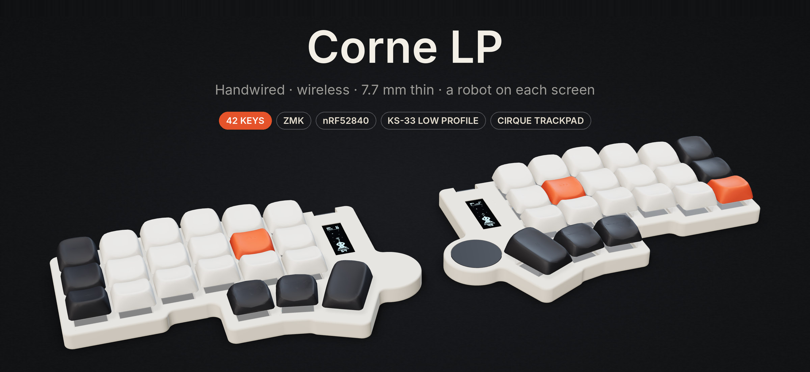
</p>

<p align="center">
  
  
  
  
  
</p>

<p align="center">
  <a href="https://fbiopeningupp.github.io/corne-lp-handwired/"><b>Website</b></a> ·
  <a href="docs/build-guide.md"><b>Build guide</b></a> ·
  <a href="#gallery"><b>Gallery</b></a> ·
  <a href="#meet-blip"><b>Meet Blip</b></a> ·
  <a href="#keymap"><b>Keymap</b></a> ·
  <a href="print"><b>Print files</b></a> ·
  <a href="firmware"><b>Firmware</b></a> ·
  <a href="https://fbiopeningupp.github.io/corne-lp-handwired/viewer/"><b>3D viewer</b></a>
</p>

---

The Corne is a great split keyboard, but most builds are tall, tethered and need a PCB order. This one is none of those. It's a 42-key Corne you can **build with a soldering iron and a 3D printer**, sized around Gateron's KS-33 low-profile switches. It runs **wireless** with no cable between the halves, and it's slim enough that the two halves **snap together back-to-back** and slide into a bag.

Every part here is generated from code. The case, keycaps, carry case and wire routes all come from the Python in [`case/`](case), and the renders on this page come from those same meshes.

<p align="center">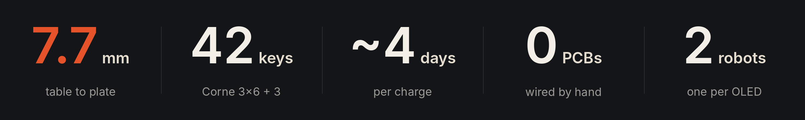</p>

<table>
  <tr>
    <td width="50%">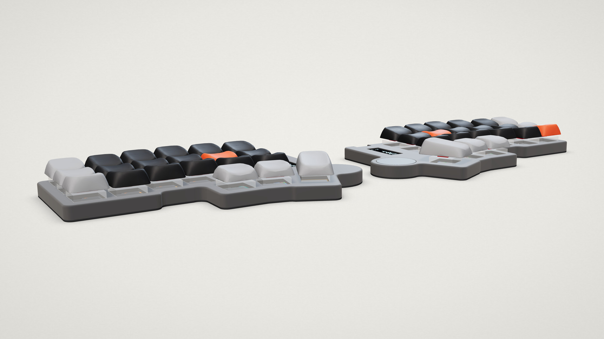</td>
    <td width="50%">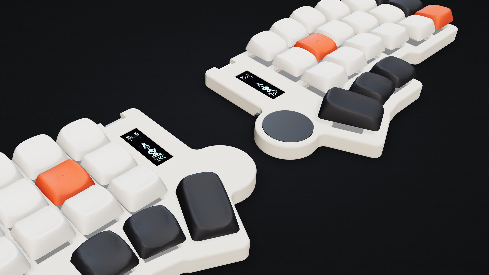</td>
  </tr>
  <tr>
    <td><b>7.7 mm</b> from the table to the top of the plate. A 6.7 mm shell plus a 1 mm base, with a rounded 1 mm top edge.</td>
    <td><b>Blip</b> lives on a 0.91″ OLED in each half. He types when you type, throws sparks as you speed up and grows a flame crown past 70 WPM.</td>
  </tr>
  <tr>
    <td width="50%">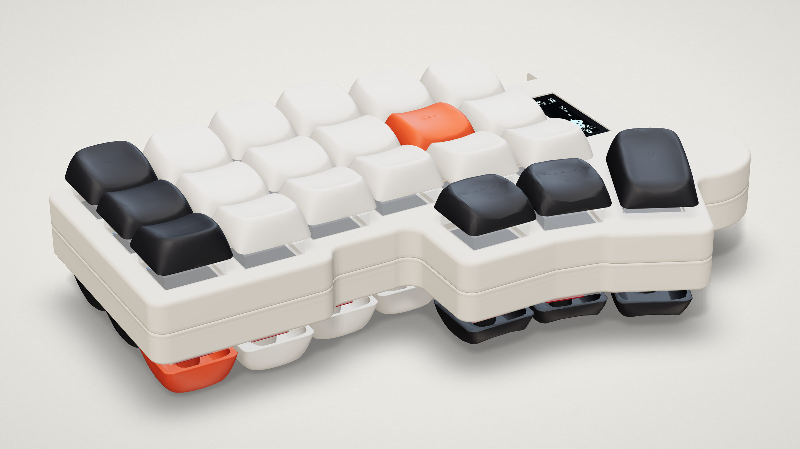</td>
    <td width="50%">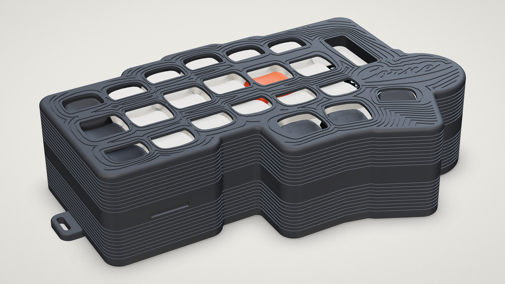</td>
  </tr>
  <tr>
    <td><b>Bag mode.</b> Four magnets per base pull the halves together back-to-back, keycaps out. The feet of one half drop into empty pockets on the other.</td>
    <td><b>Carry case.</b> A two-piece shell clicks shut around the stack, with a window for every key and both OLEDs. A thinner open bumper version is also included.</td>
  </tr>
</table>

## Highlights

- **Wireless split:** a SuperMini nRF52840 in each half running [ZMK](https://zmk.dev), with a custom `corne_lp` keyboard definition and stock Corne pinout.
- **Trackpad:** a Cirque 23 mm GlidePoint on the right half, right next to the thumb keys. Tap to click, or use the home-row mouse buttons.
- **Battery:** a 120 mAh LiPo in each half, tucked under the thumb lobe. About 4 days per charge (estimated).
- **Sculpted keycaps:** [CLP](https://github.com/vvhg1/clp-keycaps) caps reworked for the KS-33 with a 2.1 mm longer stem, so you get the full 3.2 mm of travel. All 42 are laid out and ready to slice.
- **Details:** a side power switch, a pinhole reset button you press with a paperclip, a cursive *Corne* signature engraved under each half, and screws into brass inserts.
- **Print-first test kit:** a 25-minute print that checks switch fit, magnet and insert holes, the reset button and a keycap before you commit to the full case.

## Specs

| | |
|---|---|
| Layout | Corne 3×6 + 3 thumb keys per half (42 keys) |
| Half size | 159 × 101 mm |
| Height | 7.7 mm (6.7 shell + 1.0 base) · 17.8–20.6 mm with keycaps |
| Switches | Gateron KS-33 Low Profile 2.0 |
| Controller | SuperMini nRF52840 (nice!nano compatible) × 2 |
| Firmware | ZMK v0.3, custom `corne_lp` shield, Cirque input module |
| Screens | 0.91″ SSD1306 128 × 32 OLED × 2 |
| Pointing | Cirque TM023023-2024-002, SPI, right half |
| Battery | WLY450838 3.7 V 120 mAh LiPo × 2 |
| Carry case | 165 × 107 × 41.7 mm, click-shut (full shell or bumper) |

---

## Gallery

<p align="center">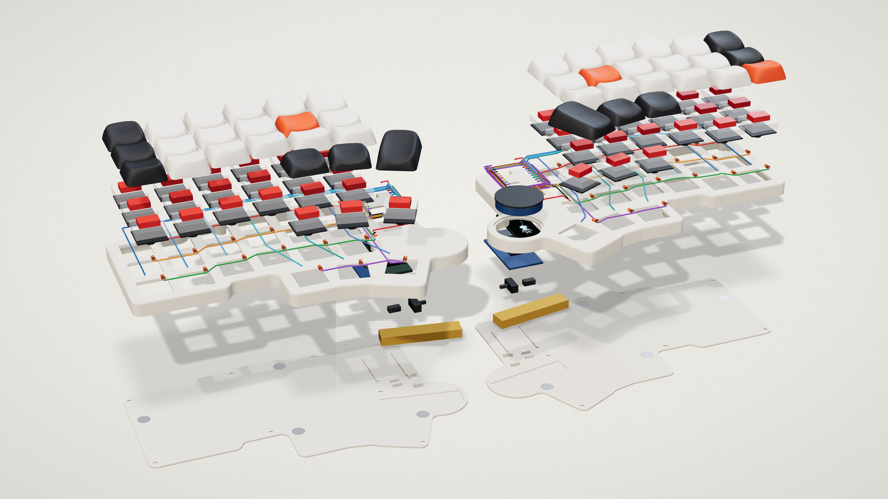</p>
<p align="center"><sub><b>Exploded.</b> Keycaps, KS-33 switches, hand-run 30 AWG rows and columns with 1N4148 diodes, the shell, OLED, SuperMini, battery, base and magnets.</sub></p>

<table>
  <tr>
    <td width="50%">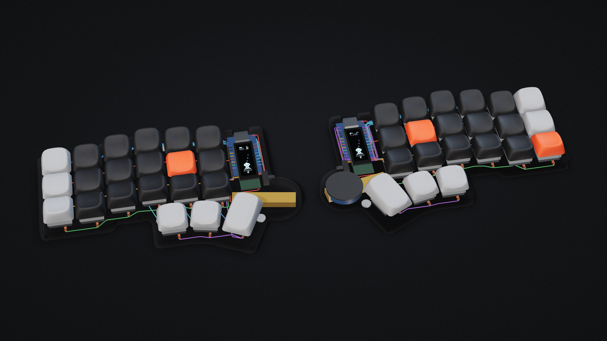</td>
    <td width="50%">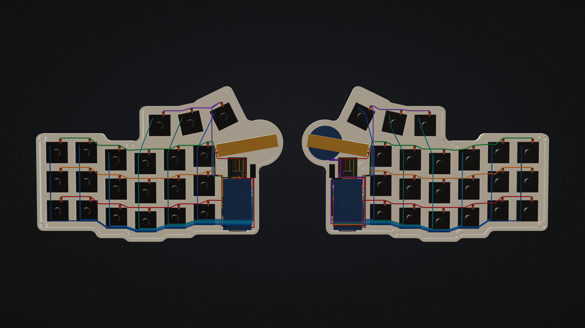</td>
  </tr>
  <tr>
    <td><sub><b>X-ray.</b> The SuperMini rides on rails under the OLED, and the battery sits under the thumb lobe.</sub></td>
    <td><sub><b>Wiring.</b> Every wire and diode, routed and clearance-checked by <code>case/routing.py</code>.</sub></td>
  </tr>
  <tr>
    <td width="50%">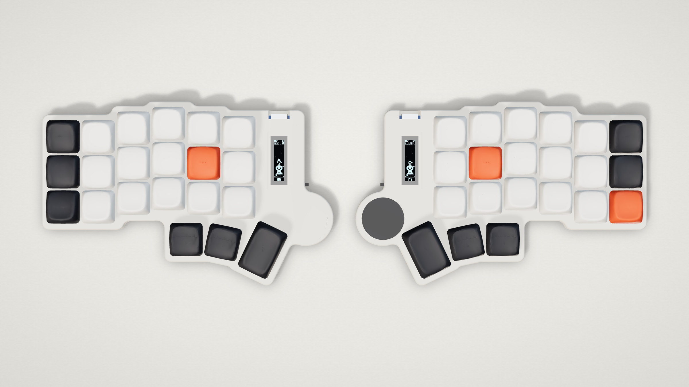</td>
    <td width="50%">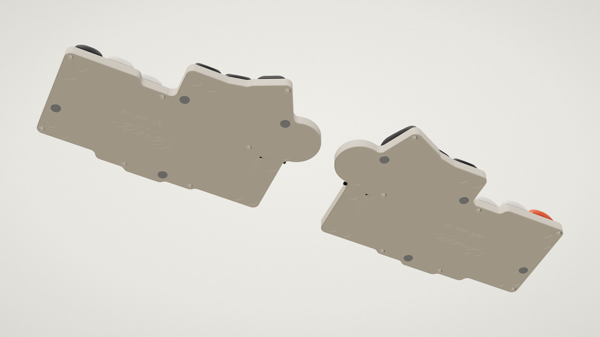</td>
  </tr>
  <tr>
    <td><sub><b>Top.</b> A Corne with the column stagger, splayed thumbs and a trackpad on the right.</sub></td>
    <td><sub><b>Underneath.</b> Magnets, feet pockets, the reset pinhole and a cursive <i>Corne</i>.</sub></td>
  </tr>
</table>

<p align="center">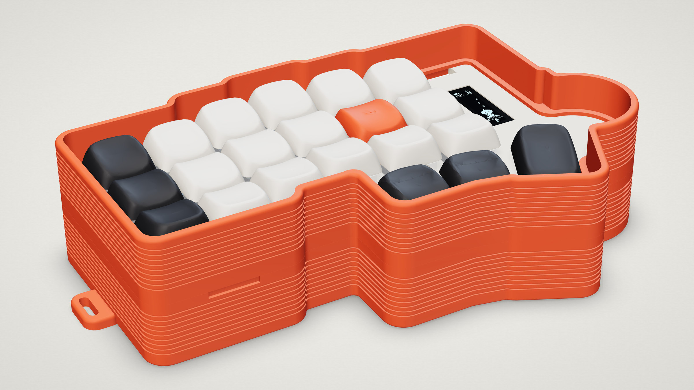</p>
<p align="center"><sub><b>Bumper case.</b> Two open frames that click together. The keys stay on show, and the rim sits just above them so nothing in your bag can press a key.</sub></p>

### Pick your colours

Any filament works. These are the colorways in the 3D viewer:

<p align="center">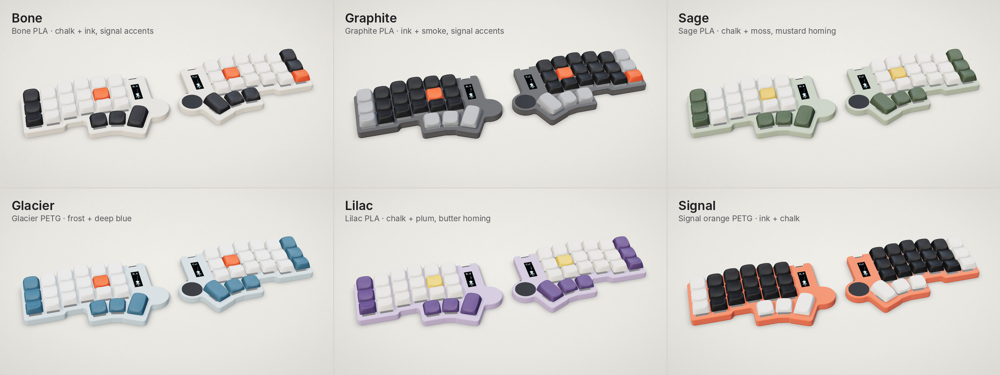</p>

---

## Meet Blip

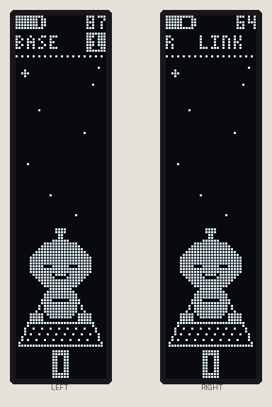

Blip is a 32 × 42 px robot drawn on each half's OLED by [`zmk-config/src/ui_core.c`](zmk-config/src/ui_core.c).

- **Typing:** his hands swap on every key press.
- **Faster:** sparks fly off his antenna, faster and denser as your WPM climbs.
- **Over 70 WPM:** a flickering flame crown appears.
- **Idle:** he blinks and bobs.
- **Stop typing:** he falls asleep with a trail of Z's, and the screens turn off after 30 s.
- **Status line:** battery level, layer name and Bluetooth profile on the left half, link status on the right.

The 3D viewer runs the same code ported line-for-line to JavaScript. You can also preview him on a PC with `tools/sim.c` (see the [build guide](docs/build-guide.md#6-firmware-edit-and-rebuild)).

<p align="center"></p>

<br clear="right">

---

## Build one

The full step-by-step is in **[docs/build-guide.md](docs/build-guide.md)**. In short:

1. **Buy the parts:** all off the shelf. See the [parts list](docs/build-guide.md#1-parts).
2. **Print the test kit** in [`print/test-kit/`](print/test-kit) and tune `HOLE`, `MAG_D` or `INSERT_HOLE` if needed.
3. **Print** the shells, bases and keycaps in [`print/`](print). The keyboard needs no supports.
4. **Flash** the pre-built firmware in [`firmware/`](firmware) before closing anything.
5. **Wire** the matrix by hand. [`docs/wiring_guide.pdf`](docs/wiring_guide.pdf) has every half and pin.
6. **Assemble:** battery, SuperMini, OLED, switch, trackpad, then 7 screws per half.

<p align="center">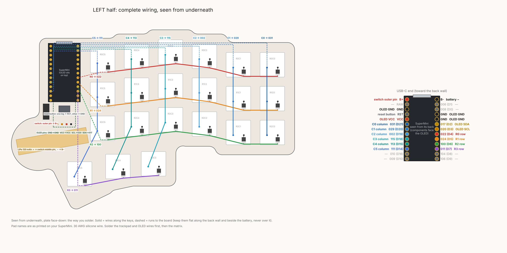</p>

## Keymap

<p align="center">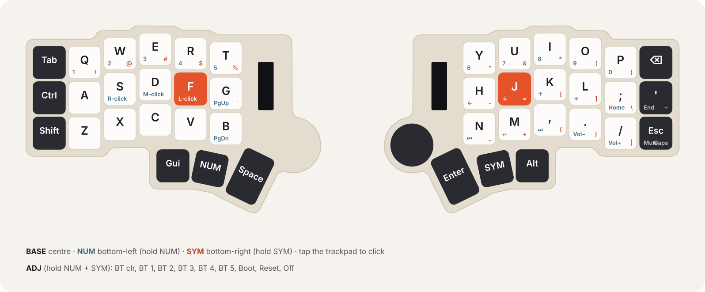</p>

| Layer | What's on it |
|---|---|
| **BASE** | QWERTY, with Ctrl / Shift / Tab on the left pinky and Esc / Bksp / ' on the right |
| **NUM** | numbers, arrows, media, and trackpad clicks (F = left, D = middle, S = right) |
| **SYM** | symbols and Caps Word |
| **ADJ** (NUM + SYM) | Bluetooth profiles 1–5, clear, bootloader on both halves, reset and soft-off |

The keymap is in [`zmk-config/config/corne_lp.keymap`](zmk-config/config/corne_lp.keymap). Push [`zmk-config/`](zmk-config) to its own repo and GitHub Actions builds both halves.

---

## What's in here

<details>
<summary><b>Repo map</b> (click to open)</summary>

```
├── print/            ready to slice
│   ├── test-kit/       print this first: switch fit, magnets, inserts, reset button, one keycap
│   ├── keyboard/       shell + base for each half
│   ├── keycaps/        all 42 CLP caps (KS-33 version) on one OrcaSlicer plate
│   └── carry-case/     click-shut carry case, or the open bumper
├── cad/              STEP solids for Fusion 360, Onshape, FreeCAD, SolidWorks
├── firmware/         pre-built .uf2 for each half
├── zmk-config/       ZMK config: keymap, corne_lp shield, Blip's status screen
├── case/             Python that generates everything (parameters at the top of case.py)
├── keycaps/          CLP keycap source models: stock (clp/) and KS-33 versions (clp_ks33/)
├── viewer/           interactive 3D viewer (dist/index.html is one self-contained page)
├── docs/             build guide, wiring guide PDF, renders and drawings
└── tools/render/     makes the renders and keymap on this page
```

</details>

## 3D viewer

**[Open the live 3D viewer](https://fbiopeningupp.github.io/corne-lp-handwired/viewer/)**, or download [`viewer/dist/index.html`](viewer/dist/index.html), a single page with the real case meshes inside, and open it in a browser. (`viewer/index.html` is only the template that `viewer/build.py` fills in; opening it sends you to the built page.) In the viewer you can:

- Spin it any way, including underneath.
- Switch between **Built**, **Exploded**, **X-ray** and **Bag** views.
- Turn on **Wiring** to see every wire and diode, and hover a wire for its name.
- Close the **carry case** or **bumper** around the stack.
- Try case and keycap colours.
- Type on your keyboard and watch Blip type along.
- Save a PNG snapshot at up to 4K.

## Make it yours

Everything is parametric. Change a number at the top of [`case/case.py`](case/case.py), re-run, and the case, STEP files, carry case, wire routes and viewer all follow. The [build guide](docs/build-guide.md#7-change-the-design) lists every script. To refresh the pictures on this page:

```
cd tools/render && npm install && node render.mjs && python3 compose.py && python3 keymap.py
```

## Credits

- **Corne** layout by [foostan](https://github.com/foostan/crkbd).
- **CLP keycaps** by [vvhg1](https://github.com/vvhg1/clp-keycaps), GPL v3. Unmodified originals are in [`keycaps/clp/`](keycaps/clp) with their licence. The KS-33 versions here only lengthen the stem.
- **[ZMK](https://zmk.dev)** firmware, and Pete Johanson's [Cirque input module](https://github.com/petejohanson/cirque-input-module).
- Renders made with [three.js](https://threejs.org) in headless Chromium.
